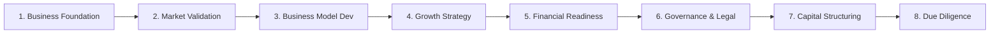

# MulaStream VentureOS — Next-Generation Venture Operating System

**MulaStream VentureOS** is an investment-readiness, business incubation, and crowdfunding orchestration operating system tailored for Namibian entrepreneurs, SMEs, and investors. Operated by **Bellatrix Investment Managers** within the **NAMFISA Regulatory Sandbox**, the platform bridges the financing gap between early-stage founders and capital providers through transparent incubation gates, verifiable evidence ledgers, and intelligent AI-guided mentorship.

---

## Table of Contents

- [Key Capabilities](#key-capabilities)
- [Platform Architecture & Workspaces](#platform-architecture--workspaces)
- [User Roles & Permissions](#user-roles--permissions)
- [Incubation Curriculum (8 Stages, 48 Deliverables)](#incubation-curriculum-8-stages-48-deliverables)
- [AI Business Mentor & Knowledge Base](#ai-business-mentor--knowledge-base)
- [WhatsApp Omnichannel Integration](#whatsapp-omnichannel-integration)
- [Project Structure](#project-structure)
- [Quick Start Guide](#quick-start-guide)
  - [Prerequisites](#prerequisites)
  - [Windows Automated Start](#windows-automated-start)
  - [Manual Setup (Windows, macOS, Linux)](#manual-setup-windows-macos-linux)
  - [Creating an Administrator Account](#creating-an-administrator-account)
  - [Configuring Environment Variables](#configuring-environment-variables)
- [Testing & Validation Guide](#testing--validation-guide)
- [Regulatory Boundaries & Important Disclosures](#regulatory-boundaries--important-disclosures)

---

## Key Capabilities

- **8-Stage 90-Day Incubation Program**: A structured roadmap comprising 48 standard deliverables guiding founders from Business Foundation to Due Diligence & Investor Engagement.
- **Dual Crowdfunding Pathways**: Native support for Debt Crowdfunding and Equity Crowdfunding structures within the Namibian regulatory framework.
- **Evidence Ledger with Cryptographic Hashing**: Upload supporting documents, pitch decks, and bank records with SHA-256 fingerprinting for immutable audit readiness.
- **Financial Lab & Scenario Modeling**: Real-time financial projections, unit economics, break-even analysis, and startup budget allocations strictly balanced in Namibian Dollars (N$ / NAD).
- **Provisional Assessment Heuristics**: Automated analysis of deliverable completeness, quantitative grounding, and evidence linkage prior to human mentor evaluation.
- **Verified Stage Progression**: Anti-fraud stage progression requiring accredited mentor and administrator sign-off before unlocking subsequent incubation tiers.
- **Investor Deal Room & Portfolio Feedback**: Published investment profiles visible to accredited investors with structured interest logging (`invest`, `collaborate`, `request information`, `decline`).
- **Context-Aware Gemini AI Mentor**: Integrated AI business mentor powered by Google Gemini, equipped with domain-specific Namibian regulatory context and business planning workflows.
- **Omnichannel WhatsApp Integration**: Twilio-powered signed webhook routing WhatsApp messages from entrepreneurs directly to the AI mentor engine.
- **Local-First & Privacy-Focused**: Zero dependency on external database clouds; fast SQLite WAL storage with Argon2id password hashing and secure HTTP-only cookies.

---

## Platform Architecture & Workspaces

```
┌─────────────────────────────────────────────────────────────────────────────┐
│                           MulaStream VentureOS                              │
├───────────────────────────────┬─────────────────────────────────────────────┤
│      Entrepreneur Workspace   │            Investor & Admin Portal          │
│  - Readiness & Rewards        │  - Vetted Deal Flow Discovery               │
│  - Mission Control Checklists │  - Verified Due Diligence Dossiers          │
│  - Venture Genome Modeler     │  - Investor Collaboration & Comments        │
│  - 90-Day Incubator (8 Stages)│  - Submission Review Queue (Mentors)        │
│  - Evidence Ledger (SHA-256)  │  - Venture Publication Gatekeeping          │
│  - Financial Lab (N$ / NAD)   │  - System Audit Ledger                      │
├───────────────────────────────┴─────────────────────────────────────────────┤
│                          Core Engine Services                               │
│  - FastAPI REST Backend & Route Protection                                  │
│  - SQLite 3 (WAL Mode, Foreign Key Enforcement, ACID Transactions)          │
│  - Google Gemini 3.5 Flash-Lite / RAG Knowledge Base (`entries.json`)       │
│  - Twilio WhatsApp HMAC-SHA1 Webhook Integration                            │
│  - Argon2id Password Cryptography & CSRF Protection                         │
└─────────────────────────────────────────────────────────────────────────────┘
```

---

## User Roles & Permissions

1. **Entrepreneur (`founder`)**:
   - Create and manage private business ventures.
   - Access the 90-Day Incubator, submit milestone deliverables, and attach supporting evidence.
   - Run financial calculations, scenario models, and budget allocations.
   - Engage with the private Gemini AI mentor and manage separate chat threads.
   - View reviewer notes and investor interest for published ventures.

2. **Investor (`investor`)**:
   - Browse the curated catalog of **Published Ventures** that completed stage-gate reviews.
   - Review executive summaries, business models, and verified evidence dossiers.
   - Submit formal investment intent (`invest`, `collaborate`, `more_information`, `decline`).
   - Leave feedback and collaborate with other accredited co-investors.

3. **Mentor & Administrator (`mentor` / `admin`)**:
   - Access the `/api/review/queue` to evaluate submitted stage deliverables.
   - Approve deliverables, award verification points, or request changes with constructive feedback.
   - Execute venture publication (`POST /api/ventures/{id}/publish`) once incubation criteria are met.
   - Inspect administrative audit logs and manage user account authorizations.

---

## Incubation Curriculum (8 Stages, 48 Deliverables)

The platform enforces an 8-stage incubation syllabus designed to prepare early-stage enterprises for formal investment:



- **Stage 1: Business Foundation** (Month 1): Concept note, problem statement, value proposition, founder profiles, ownership structure, and banking prerequisites.
- **Stage 2: Market Validation** (Month 1): Market research, customer interviews, competitor benchmarking, MVP testing, and early traction/letters of intent.
- **Stage 3: Business Model Development** (Month 1): Business Model Canvas (BMC), pricing strategy, unit economics, customer acquisition cost (CAC), and break-even calculations.
- **Stage 4: Growth Strategy & Operational Readiness** (Month 1): 3-year growth plan, sales strategy, operational delivery blueprint, and milestone KPIs.
- **Stage 5: Financial Readiness** (Month 2): Historical accounts (or zero-trading affidavits), 3-5 year forecasts, monthly cash flows, operating budgets, and sensitivity stress tests.
- **Stage 6: Governance, Legal & Compliance** (Month 2): BIPA registration documents, statutory tax compliance, sector licenses/permits, shareholder agreements, and governance controls.
- **Stage 7: Investment Structuring & Capital Readiness** (Month 2): Investment proposition, use-of-funds schedule, debt vs. equity selection, valuation modeling, and repayment schedules.
- **Stage 8: Due Diligence & Investor Engagement** (Month 3): Investor pitch deck, investment memorandum, virtual data room compilation, mock investment committee defense, and dossier export.

---

## AI Business Mentor & Knowledge Base

VentureOS features a specialized AI business mentor connected to Google Gemini:

- **Model Engine**: Defaults to `gemini-3.5-flash-lite` (or custom configured model) via the Google AI Studio API.
- **Domain RAG**: Backed by `chatbot2_engine/entries.json`, encoding verified knowledge concerning:
  - NAMFISA Regulatory Sandbox rules and admissions.
  - The Financial Institutions and Markets Act (FIMA, 2021) and the NAMFISA Act.
  - Bellatrix Investment Managers platform structure and trust custody models.
  - Debt Crowdfunding vs. Equity Crowdfunding mechanics.
- **Localized Financial Rules**: Enforces calculations strictly in Namibian Dollars (N$), requiring illustrative budget allocations to reconcile mathematically to the requested startup budget.
- **Session Continuity**: Multi-turn conversation retention, conversation renaming, topic search, and offline fallback capability.

---

## WhatsApp Omnichannel Integration

Founders in regions with limited broadband access can connect with the VentureOS AI Mentor via WhatsApp:

- **Security Verification**: Uses cryptographic HMAC-SHA1 signature validation against incoming Twilio POST requests (`X-Twilio-Signature`).
- **Data Isolation**: WhatsApp messages are stored in an isolated `whatsapp_messages` table to ensure complete data separation from web-based venture repositories.
- **Two Operating Modes**:
  - `trial`: Twilio ContentSid appointment template demonstration for sandbox verification.
  - `full`: Free-form conversational mentor responses delivered asynchronously via Twilio REST API.

---

## Project Structure

```
MulaStream_VentureOS/
├── admin_setup.py                 # Offline CLI tool to bootstrap initial admin accounts
├── app.py                         # Primary FastAPI application, SQLite schema, auth & routes
├── incubator.py                   # 8-stage syllabus definitions, deliverables, and scoring
├── platform_features.py           # Reviews, uploads, rewards, investor feed, audit logs
├── update_ventureos_investors.py  # Investor collaboration and stage-gate migration script
├── whatsapp_integration.py        # Twilio WhatsApp webhook verification and async replies
├── requirements.txt               # Pinned Python package dependencies
├── RUN_WINDOWS.bat                # One-click Windows runner (virtualenv creation & launch)
├── START_GEMINI_WINDOWS.bat       # Windows launcher pre-configured for Gemini AI
├── .env                           # Environment configuration file (API keys & ports)
├── chatbot2_engine/
│   ├── __init__.py
│   ├── entries.json               # Curated RAG knowledge chunks (NAMFISA, FIMA, Sandbox)
│   └── service.py                 # Gemini client, query classifier, prompt engineering
├── static/
│   ├── index.html                 # Unified single-page application (Landing + Workspace)
│   ├── style.css                  # Responsive design system, taskbars, cards, and modals
│   └── app.js                     # Frontend state management, views, and API client
├── screenshots/                   # Application screenshots and visual tour assets
│   └── README.md                  # Asset guidelines and resolution standards
└── data/                          # Local SQLite database directory (auto-created)
    └── ventureos.sqlite3          # SQLite database in WAL mode
```

---

## Quick Start Guide

### Prerequisites
- **Python**: Version 3.10, 3.11, or 3.12 installed.
- **Gemini API Key**: Free API key from [Google AI Studio](https://aistudio.google.com/apikey).

---

### Windows Automated Start

1. Double-click **`START_GEMINI_WINDOWS.bat`** or **`RUN_WINDOWS.bat`**.
2. The script will automatically configure a virtual environment, install packages from `requirements.txt`, and start the server.
3. Open your browser and navigate to:
   ```
   http://127.0.0.1:8000
   ```
4. Click **Create an account** to register a new Entrepreneur or Investor account.

---

### Manual Setup (Windows, macOS, Linux)

1. **Clone or extract the repository**:
   ```bash
   cd MulaStream_VentureOS
   ```

2. **Create and activate a virtual environment**:
   ```bash
   # Linux / macOS
   python3 -m venv .venv
   source .venv/bin/activate

   # Windows (PowerShell)
   python -m venv .venv
   .\.venv\Scripts\Activate.ps1
   ```

3. **Install dependencies**:
   ```bash
   pip install -r requirements.txt
   ```

4. **Set your environment variables**:
   ```bash
   # Linux / macOS
   export GEMINI_API_KEY="your-gemini-api-key"
   export GEMINI_MODEL="gemini-3.5-flash-lite"

   # Windows (PowerShell)
   $env:GEMINI_API_KEY = "your-gemini-api-key"
   $env:GEMINI_MODEL = "gemini-3.5-flash-lite"
   ```

5. **Start the application**:
   ```bash
   python -m uvicorn app:app --host 127.0.0.1 --port 8000 --reload
   ```
   Access the dashboard at **`http://127.0.0.1:8000`**.

---

### Creating an Administrator Account

To test submission reviews, stage-gate approvals, and venture publication:

1. In your terminal, run:
   ```bash
   python admin_setup.py
   ```
2. Follow the prompts:
   - Provide an admin email address (e.g. `admin@mulastream.na`).
   - Enter a display name.
   - Enter a secure password (**minimum 16 characters**).
3. Sign in through the web portal using these credentials to access the **Submission reviews** queue and administrator tools.

---

### Configuring Environment Variables

Settings can be stored in a `.env` file in the project root:

```ini
# AI Engine Configuration
GEMINI_API_KEY=your_actual_gemini_api_key_here
GEMINI_MODEL=gemini-3.5-flash-lite

# Security & Data Storage
VENTUREOS_DATA=./data
COOKIE_SECURE=0 # Set to 1 in production behind real HTTPS

# Reviewer Onboarding Secret (Optional)
MULASTREAM_REVIEWER_SETUP_SECRET=your_super_secret_activation_key_20_chars_min

# Twilio WhatsApp Integration (Optional)
TWILIO_ACCOUNT_SID=ACxxxxxxxxxxxxxxxxxxxxxxxxxxxxxxxx
TWILIO_AUTH_TOKEN=your_twilio_auth_token_here
TWILIO_WHATSAPP_FROM=whatsapp:+14155238886
TWILIO_WEBHOOK_URL=https://your-public-domain.ngrok-free.dev/api/whatsapp/webhook
TWILIO_SEND_MODE=full
```

---

## Testing & Validation Guide

To verify end-to-end functionality during a presentation or review:

1. **Entrepreneur Workflow**:
   - Register as an **Entrepreneur**.
   - Click **+ New venture** and create a sample retail enterprise (e.g. *"Kavango Organic Honey"*).
   - Navigate to **90 day incubator** and inspect Stage 1 deliverables.
   - Fill in a draft concept note and check the provisional completeness score.
   - Open **Financial lab**, input a starting capital of `N$ 25,000`, and observe the balanced cost allocation.
2. **AI Mentor Testing**:
   - Click the **AI Mentor** floating robot widget in the bottom-right corner.
   - Ask: *"I want to open a shoe repair shop in Katutura, Windhoek with N$ 10,000. Help me draft a business plan."*
   - Verify that the budget reconciles to exactly N$ 10,000 and uses practical Namibian assumptions.
   - Test conversational topic guarding: ask *"Who won the soccer match yesterday?"* and confirm it politely redirects back to business planning.
3. **Admin Review & Publication**:
   - Log in with the administrator account created via `admin_setup.py`.
   - Open **Submission reviews** to inspect pending founder drafts and evidence.
   - Issue approvals to satisfy stage requirements.
   - Publish the venture to the **Investor opportunities** catalog.
4. **Investor Exploration**:
   - Register a second account as an **Investor**.
   - Open **Investor opportunities** to review the published venture profile and export the due diligence dossier JSON.
   - Post an investor note selecting *"Interested in investing"*.

---

## Regulatory Boundaries & Important Disclosures

- **Proof of Concept Status**: This application is a local-first functional prototype intended for demonstration, stakeholder feedback, and hackathon evaluation. It is **not** a production-hardened banking or securities settlement platform.
- **Evidence Verification Disclaimer**: Uploaded documents are stored with cryptographic hashes (SHA-256) for audit tracking, but the software does not perform automated optical character recognition (OCR) or certified legal verification of uploaded artifacts. Factual due diligence requires independent human review.
- **Algorithmic Scoring**: Incubation scores evaluate structural completeness, specificity, and evidence attachment. They do not constitute an endorsement, guarantee of investment, credit rating, or certified audit.
- **Public Hosting Warning**: Do not expose this local development instance directly to the public internet using tools like ngrok without configuring production HTTPS (`COOKIE_SECURE=1`), rate limiting, verified SSL certificates, and a security audit.

---

## License & Credits

- **Compliance Framework**: NAMFISA Regulatory Sandbox Guidelines & FIMA (Act 2 of 2021).
- **Core Engineering**: Built with FastAPI, SQLite, Argon2, vanilla modern ECMAScript/CSS3, and Google Gemini.
